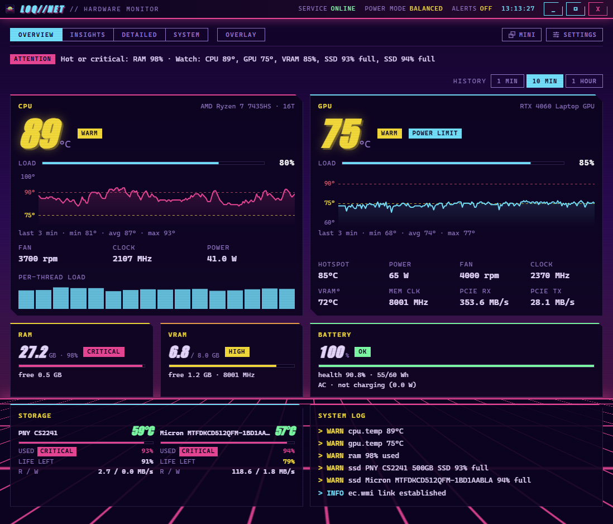
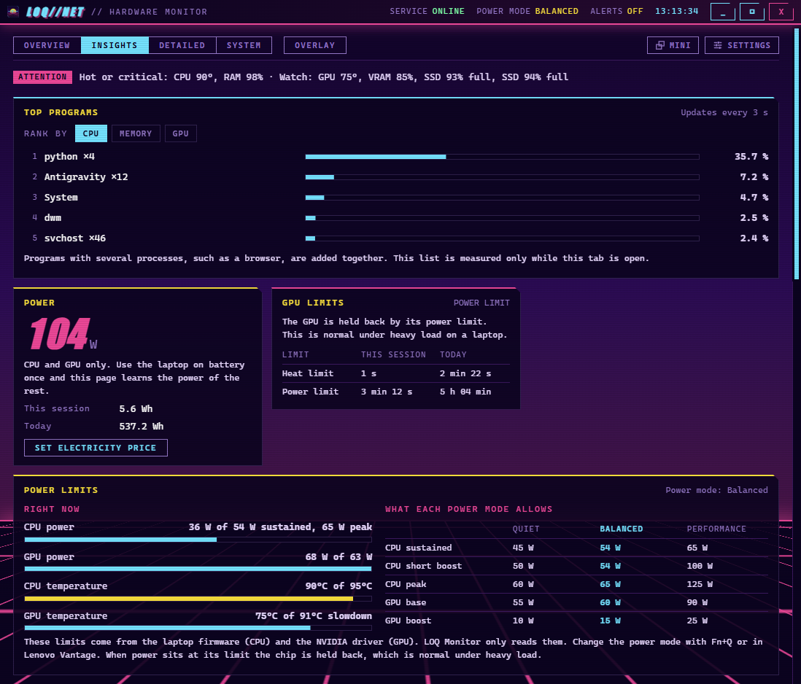
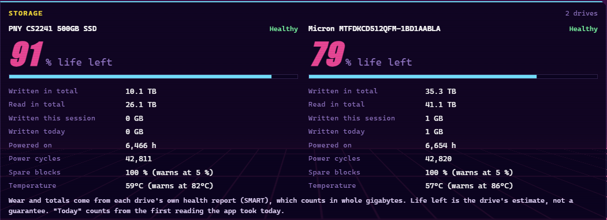
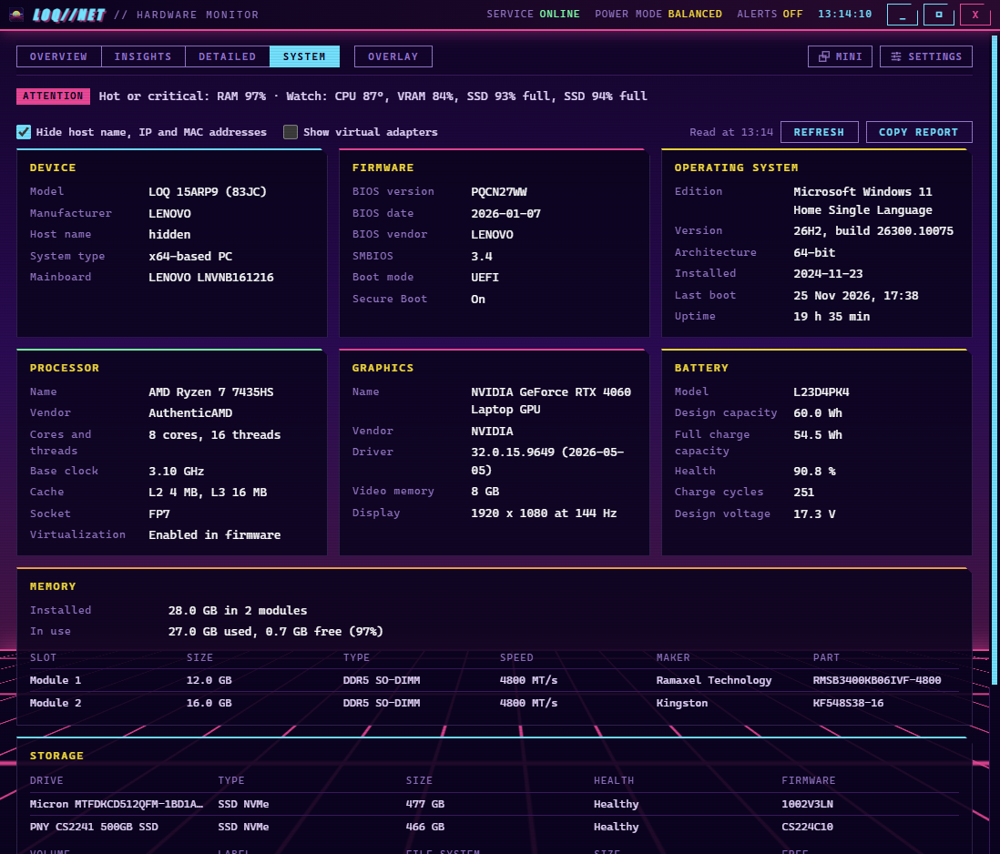
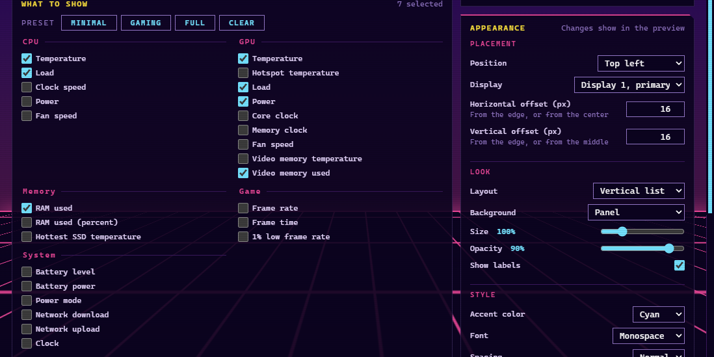
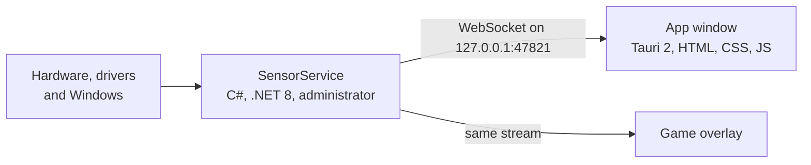

<div align="center">


# LOQ Monitor

[](https://github.com/cahyata/loq-monitor/releases/latest)
[](https://github.com/cahyata/loq-monitor/actions/workflows/release.yml)

[](LICENSE)

A hardware monitor and game overlay for the Lenovo LOQ laptop, with a NeonNet cyberwave interface.

[Install](#install) • [Features](#features) • [How it works](#how-it-works) • [Build from source](#build-from-source) • [Troubleshooting](#troubleshooting)

</div>

LOQ Monitor shows what the CPU, GPU, memory, drives, battery and network are doing, including values that only the Lenovo embedded controller reports: CPU temperature, fan speeds, power mode and power limits. It only reads. It never changes fan, power or any other hardware setting.

> [!NOTE]
> The app is built and tested on one model: the Lenovo LOQ 83JC (Ryzen 7 7435HS, RTX 4060 Laptop, Windows 11). Other LOQ models, including those with Intel processors, are not tested. Some readings can be missing or wrong on them. [docs/SENSORS.md](docs/SENSORS.md) lists the source and status of each reading.

<div align="center">



</div>

## Screenshots

| Insights | Drive health |
|---|---|
|  |  |

| System | Overlay settings |
|---|---|
|  |  |

## Features

| Page | What you get |
|---|---|
| **Overview** | CPU, GPU, RAM, VRAM, storage and battery panels, temperature charts over 1, 10 or 60 minutes, the reason the GPU is held back, and the battery time left. |
| **Insights** | Programs that use the most CPU, memory and GPU. Drive health, total data written and the programs using the drives. Power draw, energy and cost. CPU and GPU power limits per power mode. Network speed, Wi-Fi signal and ping. Session minimum, average and maximum. |
| **Detailed** | Every sensor grouped by hardware, with value, minimum and maximum, a filter and pinned favorites. |
| **System** | Device, firmware, Windows, processor, graphics, memory, drives, network and battery facts, with hidden addresses and a plain text report to copy. |
| **Diagnosis** | The times a temperature passed its limit. Hardware errors, blue screens, driver and drive errors and program crashes from the Windows Event Log. CSV export of the sensor readings of the last 6 hours. |
| **Care** | What shortens the life of the battery, cooling, drives and adapter and what helps, each tip with its source, plus advice drawn from the current readings. |
| **Overlay** | A click-through panel over your game with the readings you pick, including FPS, frame time and 1% low. Presets, order, position, display, size, color and font are adjustable. |

Also included:

- Desktop notifications when the CPU, GPU or GPU hotspot stays above your limits.
- A tray icon, a small always-on-top mini window, dark, light and system themes, and °C or °F.
- Settings that save as you change them.
- Updates from GitHub Releases that install only when you click.
- Keyboard shortcuts. Press `?` in the app for the list, and `Ctrl+Shift+O` anywhere to toggle the overlay.

## Install

1. Download `LOQ.Monitor_<version>_x64-setup.exe` from the [latest release](https://github.com/cahyata/loq-monitor/releases/latest).
2. Run it and approve the administrator prompt.
3. Choose whether the sensor service starts when you sign in.

The installer copies the app and the sensor service to `C:\Program Files\LOQ Monitor`, registers the service as a scheduled task, and installs the [PawnIO](https://github.com/namazso/PawnIO) driver with `winget` when it is missing.

> [!WARNING]
> The installer is not code signed, so Windows SmartScreen can warn you. Choose **More info**, then **Run anyway**.

To remove the app, use **Add or remove programs**. This also removes the service. PawnIO stays, because other tools can use it.

### Update

The app checks for a newer version a few seconds after it starts. Click **INSTALL AND RESTART** on the banner. To check by hand or to turn the check off, open **SETTINGS > Updates**. An update keeps your sign-in choice for the service.

## Game overlay

Turn it on in the **Overlay** tab, from the tray menu or with `Ctrl+Shift+O`. FPS readings come from [PresentMon](https://github.com/GameTechDev/PresentMon), which measures the program that has the focus without injecting into it.

> [!IMPORTANT]
> The overlay is an ordinary window, so it appears over windowed and borderless fullscreen games only. It cannot draw over exclusive fullscreen.

## How it works



- **SensorService** reads the hardware once per second and publishes a JSON snapshot. It runs as a scheduled task with the highest run level, so it starts without a UAC prompt.
- **The app** draws the snapshot and runs without administrator rights.
- **Costly measurements** (frame rate, program ranking, disk activity, network probe, power limits) run only while a window asks for them. The Event Log is read only when the Diagnosis tab asks.

The service listens on the local machine only and rejects web pages from other origins. The network traffic the app itself causes is the update check against GitHub and, while Insights is open, pings to your router and DNS server. [docs/ARCHITECTURE.md](docs/ARCHITECTURE.md) describes the protocol and design decisions.

## Build from source

You need Windows 11, the [.NET 8 SDK](https://dotnet.microsoft.com/download/dotnet/8.0), [Node.js](https://nodejs.org/) and the [Tauri prerequisites](https://tauri.app/start/prerequisites/) (Rust and the Microsoft C++ build tools).

```powershell
git clone https://github.com/cahyata/loq-monitor.git
cd loq-monitor

# Build the sensor service and fetch PresentMon next to it
dotnet publish SensorService -c Release -r win-x64 --self-contained true -o SensorService\publish
.\scripts\get-presentmon.ps1 -Destination SensorService\publish

# Register the service (administrator shell)
.\scripts\install-service.ps1 -Exe .\SensorService\publish\SensorService.exe

# Run the app with live reload
cd ui
npm install
npm run dev
```

> [!CAUTION]
> `install-service.ps1` replaces the scheduled task of an installed copy. To go back, run the script again with the path of `service\SensorService.exe` in the install folder.

Add `-NoAutoStart` to register the service without the sign-in trigger. `scripts\uninstall-service.ps1` removes it.

To build the installer, run `npx tauri build --bundles nsis` in `ui`. The build signs the update package, so set `TAURI_SIGNING_PRIVATE_KEY` to your own key, or set `bundle.createUpdaterArtifacts` to `false` in `ui/src-tauri/tauri.conf.json`. [docs/RELEASING.md](docs/RELEASING.md) explains how a release is published.

## Project layout

| Path | Contents |
|---|---|
| `SensorService/` | The C# service that reads the hardware and serves snapshots |
| `SensorProbe/` | A console tool that prints raw sensor reads for diagnosis |
| `ui/src/` | The interface in plain HTML, CSS and JavaScript, without a bundler |
| `ui/src-tauri/` | The Rust shell: tray, overlay window, updater and installer hooks |
| `scripts/` | Service install, PresentMon download, release notes and license collection scripts |
| `docs/` | [Architecture](docs/ARCHITECTURE.md), [sensors](docs/SENSORS.md), [performance](docs/PERFORMANCE.md) and [releasing](docs/RELEASING.md) |

Third-party components are listed in [THIRD-PARTY-NOTICES.md](THIRD-PARTY-NOTICES.md). LOQ Monitor is an independent project and is not affiliated with Lenovo.

## Troubleshooting

| Symptom | What to do |
|---|---|
| The app shows **OFFLINE** | Click **START SERVICE**. If it still fails, read `service.log` next to `SensorService.exe`. |
| CPU power shows `--` | The PawnIO driver is missing. Run `winget install --id namazso.PawnIO` in an administrator shell, then restart the service. |
| A card says the sensor service is older than the app | Update LOQ Monitor, or register the service from the new install. |
| Motherboard temperature or system fan reads 0 | The test model does not report them. |
| No GPU mode, battery conservation mode or Rapid Charge | These were not found in the Lenovo WMI interface of the test model. |
| A reading is missing on your machine | Run `dotnet run --project SensorProbe` in an administrator shell and compare its output with [docs/SENSORS.md](docs/SENSORS.md). |
